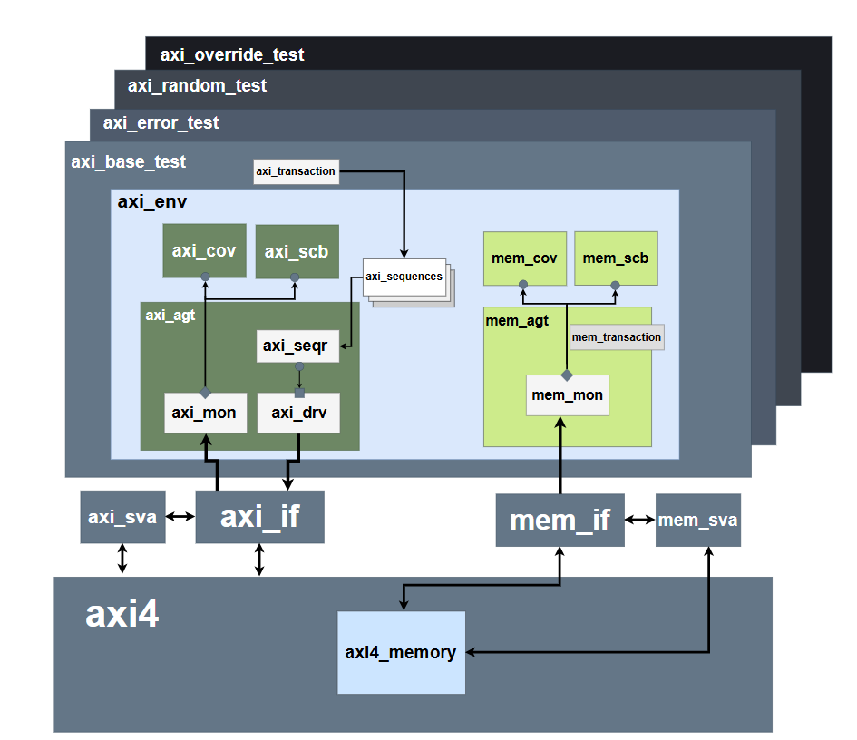

# AXI4 Memory-Mapped Slave Verification

A SystemVerilog/UVM testbench for a simplified AXI4 memory-mapped slave and its internal synchronous memory. The project checks the design from two points: the external AXI interface and the controller-to-memory interface. This makes it easier to find whether a wrong read value or response comes from the AXI controller, the memory interface, or the memory itself.

<p align="center">
  
</p>

## Coverage Highlights

The supplied QuestaSim report shows **100% in every reported DUT RTL code-coverage category**. It also reports **100% memory SVA cover-directive coverage** and zero failures across the seven memory assertions.

| Design / checker | Coverage metric | Result |
|---|---|---:|
| `axi4` | Statement coverage | **100% (87/87)** |
| `axi4` | Branch coverage | **100% (30/30)** |
| `axi4` | Condition coverage | **100% (21/21)** |
| `axi4` | Expression coverage | **100% (5/5)** |
| `axi4` | FSM state coverage | **100% (8/8)** |
| `axi4` | FSM transition coverage | **100% (9/9)** |
| `axi4` | Toggle coverage | **100% (504/504)** |
| `axi4_memory` | Statement coverage | **100% (7/7)** |
| `axi4_memory` | Branch coverage | **100% (5/5)** |
| `axi4_memory` | Toggle coverage | **100% (156/156)** |
| `mem_if` | Toggle coverage | **100% (156/156)** |
| `mem_sva` | Assertion failures | **0** |
| `axi_sva` | Assertion failures | **0** |

These are the results shown in the uploaded QuestaSim report. The functional covergroups are described in this README, but their numerical covergroup totals are not listed in that report; they should be taken from the separate functional coverage output when available.

## 1. Project Overview

The DUT consists of two main RTL blocks:

- `axi4.v` — the AXI slave controller and its read/write state machines.
- `axi_memory.v` — the internal `axi4_memory` storage block, configured as 1024 words × 32 bits.

The testbench uses two UVM agents:

- An **active AXI agent** drives reset, write, and read transactions.
- A **passive memory agent** monitors the internal memory signals without driving the design.

Each side has its own monitor, scoreboard, and functional coverage collector. The AXI scoreboard checks the transaction as seen by a bus master. The memory scoreboard checks the accesses observed at the internal memory interface. Their shadow memories are independent by design, so both checkers do not simply repeat the same model or rely on the same observed transaction object.

### Scope

This is a simplified AXI4-style interface focused on the AW, W, B, AR, and R channels. It does not implement every optional AXI4 feature. The current interface does not expose signals such as `AWBURST`, `ARBURST`, `WSTRB`, or transaction IDs, so the testbench should not be described as a complete verification environment for all AXI4 features.

## 2. DUT Configuration and Addressing

| Item | Configuration | Description |
|---|---:|---|
| AXI data width | 32 bits | One full-width data beat carries 4 bytes |
| AXI address width | 16 bits | External addresses are byte addresses |
| Memory depth | 1024 words | 1024 individually addressable words |
| Memory word width | 32 bits | 4 bytes per word |
| Memory capacity | 4096 bytes (4 KiB) | `1024 × 4 bytes` |
| Internal memory address width | 10 bits | Selects word indices `0` through `1023` |
| Memory read behavior | Synchronous, registered output | Read data is returned after the memory's registered-read latency |
| Maximum burst length in the transaction model | 16 beats | The transaction model can represent lengths `0` through `15` |

The external AXI address is a byte address; the memory interface uses a word index. For aligned full-width accesses, the address conversion is:

```text
word_index = byte_address >> 2
byte_address = word_index << 2
```

Examples:

| Byte address | Internal word index |
|---|---:|
| `0x0000` | 0 |
| `0x0038` | 14 |
| `0x003C` | 15 |
| `0x0040` | 16 |
| `0x0FFC` | 1023 |

The first aligned word address is `0x0000`; the last is `0x0FFC`. A 4 KiB region spans `0x0000` through `0x0FFF`. A burst whose exclusive end address is exactly `0x1000` ends at the region boundary without crossing it. An exclusive end address greater than `0x1000` crosses the boundary.

For a full-width burst:

```text
beats                 = AxLEN + 1
bytes_per_beat        = 4
transfer_bytes        = beats * bytes_per_beat
exclusive_end_address = start_address + transfer_bytes
```

The `+1` in `AxLEN + 1` is important: AXI length fields encode the number of beats minus one. A boundary calculation that uses `AxLEN * 4` undercounts a full-width burst by one beat.

### Registered memory read latency

The memory output is registered. The controller must allow the requested word to become available before placing it on the AXI R channel. In the fixed controller, the `R_WAIT` state separates the memory access from the read-data presentation. The memory scoreboard also models this latency using a pending-read expectation, rather than comparing the memory result in the same cycle as the request.

## 3. Verification Architecture

<p align="center">
  
</p>

### AXI path

1. The UVM test starts a sequence.
2. The sequence creates `axi_transaction` items for reset, write, or read operations.
3. The sequencer passes each item to the active AXI driver.
4. The driver drives the AXI interface and waits for the relevant handshakes.
5. The AXI monitor observes the interface pins and reconstructs the completed transaction.
6. The AXI monitor publishes the observed transaction to both the AXI scoreboard and AXI coverage collector.

### Memory path

1. `mem_if` is attached to the internal `axi4_memory` instance through `bind`.
2. The passive memory monitor samples reset, enable, write enable, word address, write data, and read data.
3. The monitor publishes a memory snapshot each clock.
4. The memory scoreboard compares observed activity and registered read data against its own reference model.
5. The memory coverage collector samples memory controls, addresses, and data patterns.

### Why two scoreboards?

The two scoreboards intentionally observe different points in the design.

- **`axi_scoreboard`:** maintains an AXI-side shadow memory and checks expected read data and response behavior from the transaction reconstructed at the external interface.
- **`mem_scoreboard`:** maintains a separate memory-side shadow memory, updates it from observed memory writes, and checks the registered read result at the expected later cycle.

If the memory-side data is correct but the AXI read is wrong, the controller's read path or timing becomes a likely suspect. If the internal memory access itself is wrong, the memory controls or address conversion deserve closer inspection. Separate monitors also prevent the scoreboard from simply trusting what the driver intended to send.

## 4. Testbench Components

| File | Purpose |
|---|---|
| `axi_if.sv` | AXI signals and `MASTER`, `SLAVE`, and `MONITOR` modports |
| `mem_if.sv` | Monitor-only interface for internal memory activity |
| `common_cfg_pkg.sv` | Shared AXI and memory configuration objects |
| `axi_transaction_pkg.sv` | AXI transaction class and reset/write/read operation definitions |
| `mem_transaction_pkg.sv` | Memory-cycle snapshot transaction |
| `axi_sequence_pkg.sv` | Reset, write/read, and corner-address sequences |
| `axi_sequencer_pkg.sv` | AXI sequencer |
| `axi_driver_pkg.sv` | AXI and reset stimulus; includes the normal driver and a delay/backpressure-capable variant in the working source |
| `axi_monitor_pkg.sv` | Reconstructs AXI transactions from observed interface signals |
| `mem_monitor_pkg.sv` | Samples the internal memory interface |
| `axi_agent_pkg.sv` | Active AXI agent with driver, sequencer, and monitor |
| `mem_agent_pkg.sv` | Passive memory agent with a monitor only |
| `axi_scoreboard_pkg.sv` | AXI-side shadow memory and response/data checks |
| `mem_scoreboard_pkg.sv` | Memory-side shadow memory and latency-aware read checks |
| `axi_coverage_pkg.sv` | Functional coverage for AXI transactions |
| `mem_coverage_pkg.sv` | Functional coverage for internal memory activity |
| `axi_env_pkg.sv` | Creates agents, scoreboards, and coverage; connects analysis ports |
| `axi_test_pkg.sv` | UVM tests and sequence orchestration |
| `axi_pkg.sv` | Umbrella package |
| `axi_top.sv` | Clock, interfaces, DUT, memory bind, `config_db`, and `run_test` |
| `axi_files.list` | Source/RTL compilation order |
| `run.do` | Single simulation setup and run |
| `run_regression.do` | Multi-seed regression and report-generation flow |
| `wave.do` | Waveform grouping and display setup |
| `axi4.drawio` | Editable architecture diagram |
| `images/architecture.png` | Architecture image used by this README |
| `AXI4_Verification_Plan.xlsx` | Requirements, tests, coverage, assertions, and bug-tracking workbook |
| `SVA/mem_sva.sv` | Memory-interface assertions and cover directives used for the supplied memory-SVA results |
| `SVA/axi_sva.sv` | AXI-interface checker developed for selected AXI rules; verify its compile/bind integration in the published branch before claiming it was included in the supplied report |

> Keep the file list synchronized with the repository. The uploaded coverage report confirms a `mem_sva` checker was compiled for that run, but it does not show AXI SVA results. The AXI checker should only be described as included in a particular coverage run after it is compiled, instantiated/bound once, and visible in the resulting report.

## 5. AXI Interface and Transaction Model

The interface groups the protocol into five channels:

| Channel | Example signals | What is transferred |
|---|---|---|
| AW | `AWADDR`, `AWLEN`, `AWSIZE`, `AWVALID`, `AWREADY` | Write address and transfer attributes |
| W | `WDATA`, `WLAST`, `WVALID`, `WREADY` | Write-data beats and final-beat marker |
| B | `BRESP`, `BVALID`, `BREADY` | Write completion response |
| AR | `ARADDR`, `ARLEN`, `ARSIZE`, `ARVALID`, `ARREADY` | Read address and transfer attributes |
| R | `RDATA`, `RRESP`, `RLAST`, `RVALID`, `RREADY` | Read-data beats, response, and final-beat marker |

A channel handshake occurs at a sampled rising edge when both `VALID` and `READY` are high. The source must keep `VALID` and its payload stable while the receiver is not ready. For a write burst, the master provides one AW transfer followed by the requested number of W beats and then receives one B response. For a read burst, the master provides one AR transfer and receives the requested number of R beats.

The transaction model uses three operations: `AXI_RESET`, `AXI_WRITE`, and `AXI_READ`. The reset sequence sends a reset item through the same sequencer/driver path; the reset duration is constrained to 3–6 cycles. Write and read items carry the address, length, size, and data required by the driver. With `burst_en` disabled, the model uses one beat (`AxLEN=0`); when enabled, the configured transaction length can represent up to 16 beats (`AxLEN=15`).

## 6. Current Tests and Sequences

The default `axi_base_test` runs the reset, write/read, and corner-address sequences in order.

| Sequence | Stimulus | Purpose |
|---|---|---|
| `axi_base_sequence` | Abstract parent | Common sequence base |
| `axi_reset_seq` | One reset pulse; duration randomized over 3–6 cycles | Starts the test from a known reset state |
| `axi_write_read_seq` | Random aligned address and 32-bit data; write then read back | Basic end-to-end data-integrity test |
| `axi_corner_addr_seq` | Accesses word indices `0`, `14`, `15`, `16`, `30`, `31`, and `1023` | Exercises the first word, the last word, and addresses around the original memory-read bug locations |

The corner-address sequence uses data patterns such as `32'hFFFF_FFFF`, `32'h0000_0000`, and walking-one patterns. These help catch accidental truncation, masking, or selection of an adjacent memory word.

The transaction classes, driver, and monitor are burst-aware, but the default sequence set does not constitute a full burst/error-path campaign. The default passing run should be described as passing its directed reset, read/write, and corner-address scenarios—not as proving every planned AXI behavior.

### Additional scenarios for a more complete regression

- Legal multi-beat bursts, including the maximum configured length.
- A burst ending exactly at a 4 KiB boundary.
- A burst crossing a 4 KiB boundary, expected to be rejected according to the DUT's supported response policy.
- Out-of-range addresses.
- Reset asserted between transactions and reset during active traffic.
- Response and read-data backpressure (`BREADY`/`RREADY` low while `VALID` is high).
- Incorrect or early `WLAST`/`RLAST` behavior.
- Watchdog/timeouts for a channel that never completes its handshake.

## 7. Checking Strategy

### AXI scoreboard

The AXI scoreboard keeps its own reference memory. For a write, it uses the observed address and data beats to model the expected state. For a read, it compares each returned beat against that reference state and checks response expectations based on the configured memory range and boundary rules. The scoreboard also uses beat count and transfer size to reason about address progression.

For the 32-bit configuration, the byte address for full-width beat `i` is:

```text
beat_address(i) = start_address + (i * 4)
```

The total transaction size is `((AxLEN + 1) * 4)` bytes. Any 4 KiB crossing check must use that full transfer size, rather than treating `AxLEN` as the number of actual beats.

### Memory scoreboard

The memory scoreboard receives one observed memory transaction snapshot per clock. It tracks writes in its separate shadow array and models the synchronous read output using a pending-read record. It checks that the read result corresponds to the earlier requested word and observes reset-related behavior.

The currently documented memory scoreboard tracks a single pending read. Before using overlapping or multiple outstanding read requests, the pending-read model should be extended to support the intended concurrency.

### Monitor timing

The AXI and memory monitors sample after the clock edge with a small delay in the current implementation to avoid races with nonblocking assignments from the DUT/driver. If this is changed, the sampling method should remain consistent across all monitors. A clocking-block-based approach is another option for a larger refactor.

## 8. Functional Coverage

The functional coverage collectors sample monitor-observed transactions and memory signals, not the driver's intended values.

### AXI functional coverage (`axi_coverage`)

The AXI covergroup tracks the following categories:

- Operation type: reset, write, and read.
- `burst_en` setting.
- Read/write burst length bins: one-beat length, short lengths, and longer configured lengths.
- Transfer-size values.
- Response values (`OKAY` and `SLVERR` for the current response model).
- Address regions: zero/first word, low region, middle region, high region, and final word (`0x0FFC`).
- Reset duration.
- Write/read data patterns per observed beat or transaction, as defined in the coverage package.
- Selected crosses between transaction attributes, lengths, response categories, address regions, and patterns.

The current address bins use byte-address ranges, not internal word indices. Out-of-range stimulus needs explicit coverage if it is part of the intended verification closure.

### Memory functional coverage (`mem_coverage`)

The memory covergroup tracks:

- Enabled memory cycles versus idle cycles.
- Read/write control values.
- Internal word-address regions and corner indices.
- Write-data patterns during writes.
- Read-data patterns during reads.
- Reset-related activity.
- Address/control crosses.

Because memory snapshots are sampled every cycle, the value of `mem_we` should be interpreted alongside `mem_en`. A value of `mem_we` while `mem_en=0` should not be treated as a completed memory access.

## 9. SystemVerilog Assertions

The memory checker in `SVA/mem_sva.sv` contains seven assertions, each paired with a cover directive. The checks reported by Questa include:

| Assertion | Intended check | Failures in supplied report | Pass count reported |
|---|---|---:|---:|
| `reset_assertion` | Reset-time memory-interface behavior | 0 | 72 |
| `write_enable_assertion` | `mem_we` must not be asserted when `mem_en` is low | 0 | 2,884 |
| `address_known_assertion` | Memory address must be known during relevant accesses | 0 | 7,191 |
| `address_range_assertion` | Memory address must be within the configured depth | 0 | 7,191 |
| `write_data_assertion` | Write data must be known during writes | 0 | 2,884 |
| `read_data_known_assertion` | Read data must be known when expected | 0 | 4,307 |
| `read_data_stable_assertion` | Read data remains stable when no new read updates it | 0 | 35,239 |

All seven unique memory-SVA cover directives were hit in the supplied report. The assertion report also records vacuous and disabled evaluations, as expected for properties whose antecedent is not true on every sampled cycle. A high cover-directive count should not be read as proof that a violation scenario was exercised; it means the cover property itself matched.

The report lists the memory checker under two Questa hierarchy strings: `/\\axi_top#dut /mem_inst/memory_assertions` and `/\\axi_top#dut#mem_inst /memory_assertions`. Their counts match. Before publishing the UCDB as final evidence, check the elaborated hierarchy and bind setup to confirm whether these are alternate paths to the same bound instance or two elaborated checker instances. The directive table repeats the same seven cover statements under both strings; the unique directive set is seven.

### Assertion and coverage distinction

- An **assertion** flags a violation of the stated rule.
- A **cover directive** records that a defined event or property sequence occurred.
- An uncovered stall property usually means the test did not produce that stall; it does not, by itself, mean the assertion failed.

The AXI SVA work checks selected protocol conditions such as reset/VALID behavior, known signal values, supported response encodings, `RLAST` consistency, response timing, and single-beat completion. The supplied coverage report does not show numeric AXI SVA results, so the tables above report only the memory checker that appears in that run.

## 10. QuestaSim RTL Code-Coverage Results

The table below captures the DUT RTL results from the supplied report. The run reached every bin in each listed code-coverage category for `axi4` and `axi4_memory`.

### AXI controller: `axi4`

| Metric | Covered | Result |
|---|---:|---:|
| Statements | 87 / 87 | **100%** |
| Branches | 30 / 30 | **100%** |
| Conditions | 21 / 21 | **100%** |
| Expressions | 5 / 5 | **100%** |
| FSM states | 8 / 8 | **100%** |
| FSM transitions | 9 / 9 | **100%** |
| Toggle bins | 504 / 504 | **100%** |

The state-coverage counts include four write FSM states and four read FSM states.

**Write FSM states covered:**

| State | Role | Hits reported |
|---|---|---:|
| `W_IDLE` | Wait for a write address | 1,016 |
| `W_ADDR` | Move from address acceptance to write-data phase | 980 |
| `W_DATA` | Accept write-data beats and issue memory writes where legal | 980 |
| `W_RESP` | Hold/complete the write response | 980 |

**Write FSM transitions covered:**

| Transition | Hits reported |
|---|---:|
| `W_IDLE -> W_ADDR` | 980 |
| `W_ADDR -> W_DATA` | 980 |
| `W_DATA -> W_RESP` | 980 |
| `W_RESP -> W_IDLE` | 980 |

**Read FSM states covered:**

| State | Role | Hits reported |
|---|---|---:|
| `R_IDLE` | Wait for a read address | 1,016 |
| `R_ADDR` | Launch the first memory read for a legal request | 980 |
| `R_WAIT` | Wait for the registered memory output | 4,568 |
| `R_DATA` | Present read data and process read handshakes | 4,568 |

**Read FSM transitions covered:**

| Transition | Hits reported |
|---|---:|
| `R_IDLE -> R_ADDR` | 980 |
| `R_ADDR -> R_WAIT` | 980 |
| `R_WAIT -> R_DATA` | 4,568 |
| `R_DATA -> R_IDLE` | 980 |
| `R_DATA -> R_WAIT` | 3,588 |

The `R_DATA -> R_WAIT` transition is the repeated-read path used when another beat remains. The run exercises both the final-beat return to idle and the non-final path back to the wait state.

### Internal memory: `axi4_memory`

| Metric | Covered | Result |
|---|---:|---:|
| Statements | 7 / 7 | **100%** |
| Branches | 5 / 5 | **100%** |
| Toggle bins | 156 / 156 | **100%** |

The report shows activity through the reset branch, the memory-enable branch, and both read/write outcomes. The branch counts include 2,884 writes and 4,307 reads at the memory interface.

### Memory interface: `mem_if`

| Metric | Covered | Result |
|---|---:|---:|
| Toggle bins | 156 / 156 | **100%** |

The interface toggle report includes activity on the clock, reset, memory enable/write controls, address, and data signals.

### Coverage interpretation

These are code-coverage metrics for the selected DUT and interface instances. They show that the instrumented statements, branches, conditions, expressions, FSM states/transitions, and toggle bins were exercised in the supplied run. They do not remove the need for functional scenarios such as directed 4 KiB crossings, invalid accesses, or backpressure tests. Those scenarios should be added and checked explicitly if they are part of the verification requirements.

## 11. Bugs Found and Fixes

The project keeps `Buggy_RTL` and `Fixed_RTL` so the original issues can be investigated and compared against corrected behavior.

| Bug | Block | Finding | Status |
|---|---|---|---|
| BUG-01 | `axi4_memory` | The original implementation used the wrong reset polarity, so reset handling occurred at the wrong level. | Fixed in `Fixed_RTL` with active-low reset handling and array clearing. |
| BUG-02 | `axi4_memory` | Certain memory addresses selected `mem_addr - 1` and masked the returned data to 28 bits. | Fixed in `Fixed_RTL`; the read uses `memory[mem_addr]`. The corner-address sequence exposed the problem. |
| BUG-04 | `axi4` | The controller captured registered memory data too early, causing stale or zero read results. | Fixed in `Fixed_RTL` by adding an `R_WAIT` state. |
| BUG-03 | `axi4` | The 4 KiB boundary check was identified as an off-by-one calculation of burst bytes. | Requires a confirmed fix and dedicated crossing/non-crossing tests. |

The boundary condition must use `(AxLEN + 1)` to obtain the number of beats. For the current 32-bit configuration, a full-width burst consumes `(AxLEN + 1) * 4` bytes. The key directed tests should include a transfer that ends exactly at a 4 KiB boundary and another that extends beyond it. The expected response should be checked at both AXI and memory observation points.

### Suggested before/after workflow

1. Select `Buggy_RTL` in `axi_files.list`.
2. Run the same test and seed, and save the failure log and waveform.
3. Select `Fixed_RTL` and rerun with the same test and seed.
4. Confirm that the original failure disappears for the intended reason.
5. Keep the assertion and scoreboard expectations unchanged while comparing the two designs.

## 12. Repository Layout

```text
AXI4-Memory-Mapped-Slave-Verification/
├── Buggy_RTL/
│   ├── axi4.v
│   └── axi_memory.v
├── Fixed_RTL/
│   ├── axi4.v
│   └── axi_memory.v
├── images/
│   └── architecture.png
├── SVA/
│   ├── axi_sva.sv
│   └── mem_sva.sv
├── axi_if.sv
├── mem_if.sv
├── common_cfg_pkg.sv
├── axi_transaction_pkg.sv
├── mem_transaction_pkg.sv
├── axi_sequence_pkg.sv
├── axi_sequencer_pkg.sv
├── axi_driver_pkg.sv
├── axi_monitor_pkg.sv
├── mem_monitor_pkg.sv
├── axi_agent_pkg.sv
├── mem_agent_pkg.sv
├── axi_scoreboard_pkg.sv
├── mem_scoreboard_pkg.sv
├── axi_coverage_pkg.sv
├── mem_coverage_pkg.sv
├── axi_env_pkg.sv
├── axi_test_pkg.sv
├── axi_pkg.sv
├── axi_top.sv
├── axi_files.list
├── run.do
├── run_regression.do
├── wave.do
├── axi4.drawio
├── AXI4_Verification_Plan.xlsx
└── README.md
```

Keep this tree synchronized with the actual repository. If a local file has not been committed yet, add it to Git before relying on the README as the public file inventory.

## 13. Requirements

- QuestaSim with SystemVerilog support. The project was originally documented with QuestaSim 2021.1.
- UVM 1.1d from the configured simulator installation.
- Run commands from the repository root, where `run.do`, `run_regression.do`, `axi_files.list`, and `wave.do` are located.

The scripts use Questa commands such as `vlog`, `vsim`, `coverage save`, and `vcover`.

## 14. Run the Testbench

Open the Questa Transcript in the repository folder and execute:

```tcl
do run.do
```

The single-run script compiles the files listed in `axi_files.list`, starts `work.axi_top` with `+UVM_TESTNAME=axi_base_test`, loads the waveform setup from `wave.do`, and runs the simulation. It enables internal signal access for debug and collects the configured coverage metrics.

To run another registered test, change the `+UVM_TESTNAME` argument or provide the required test name in the simulator invocation. The test must be implemented, registered with the UVM factory, and included in the compile flow.

### Compile order

The compile list should respect package dependencies: RTL and interfaces first, followed by common configuration and transaction packages, sequence/sequencer/driver/monitor packages, agents, scoreboards, coverage, environment, tests, umbrella package, and top module. The SVA modules must be compiled before the module in which they are instantiated or bound.

## 15. Multi-Seed Regression

Run the regression script from the Questa Transcript:

```tcl
do run_regression.do
```

The script is configured to run `axi_base_test` across five generated seeds by default. The settings near the top can be edited to choose tests and fixed seeds:

```tcl
set tests {axi_base_test}
set num_seeds 5
set seed_list {74865 738726}
```

When `seed_list` contains values, those seeds are used instead of generating a new set. Only list test classes that exist in the compiled project.

The regression script saves a log and coverage database for each run, merges the databases, generates text/HTML reports, and creates a summary of UVM errors and fatals. Exact output names depend on the current script configuration; the working setup uses the `logs/` and `cov_results/` directories.

| Output | Purpose |
|---|---|
| `logs/` | Per-test/per-seed simulation logs |
| `cov_results/cov_<test>_seed<seed>.ucdb` | Coverage database for an individual run |
| `cov_results/merged_cov.ucdb` | Merged coverage database |
| `cov_results/cov_report.txt` | Text code-coverage report |
| `cov_results/cov_report_html/` | HTML coverage report |
| `cov_results/func_cov_report.txt` | Functional covergroup report, if generated by the selected script flow |
| `cov_results/regression_summary.txt` | Per-run status based on UVM error/fatal counts |
| `cov_results/seeds_used.txt` | Tests and seeds used for the regression |

The summary script classifies a run as PASS when the scanned log contains zero `UVM_ERROR` and zero `UVM_FATAL` counts. A PASS only reflects the checks and stimulus that actually ran; inspect assertion, functional, and DUT code-coverage reports separately.

### Reproducing a failure

Record the test name and random seed from the log, set that seed in `run_regression.do`, and rerun only the affected test. Keep the waveform and error transcript from both the failing and corrected versions. This makes the debug result repeatable and easier to review.

## 16. Switch Between Buggy and Fixed RTL

`axi_files.list` points to `Fixed_RTL/` by default. To run the original injected-bug version, change the RTL paths to:

```text
Buggy_RTL/axi4.v
Buggy_RTL/axi_memory.v
```

The goal of the project is to have a repeatable way to stimulate the design, compare observed behavior against independent reference models, identify the point where behavior diverges, and support the result with coverage and waveform evidence. Code coverage tells which instrumented RTL paths ran; functional coverage and directed checks remain necessary to show that the intended protocol scenarios were exercised.
